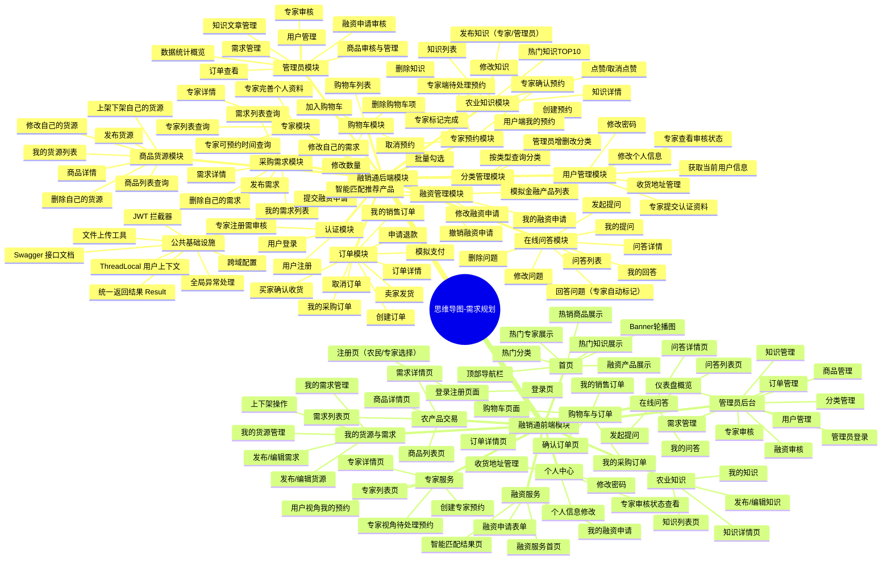

# 融销通 思维导图 - 需求规划

## Mermaid 格式（支持粘贴到 ProcessOn / XMind / draw.io 直接渲染）



---

## ProcessOn / XMind 手动搭建参考（按层级复制即可）

根节点：思维导图-需求规划

━━━ 第一层 Epic（橙色标签）━━━

1. 融销通后端模块
2. 融销通前端模块

━━━ 第二层 Feature（蓝色标签）━━━

▼ Epic: 融销通后端模块
  ├─ Feature: 公共基础设施
  ├─ Feature: 认证模块
  ├─ Feature: 用户管理模块
  ├─ Feature: 分类管理模块
  ├─ Feature: 商品货源模块
  ├─ Feature: 采购需求模块
  ├─ Feature: 购物车模块
  ├─ Feature: 订单模块
  ├─ Feature: 专家模块
  ├─ Feature: 在线问答模块
  ├─ Feature: 专家预约模块
  ├─ Feature: 农业知识模块
  ├─ Feature: 融资管理模块
  └─ Feature: 管理员模块

▼ Epic: 融销通前端模块
  ├─ Feature: 登录注册页面
  ├─ Feature: 首页
  ├─ Feature: 农产品交易
  ├─ Feature: 购物车与订单
  ├─ Feature: 我的货源与需求
  ├─ Feature: 融资服务
  ├─ Feature: 专家服务
  ├─ Feature: 在线问答
  ├─ Feature: 农业知识
  ├─ Feature: 个人中心
  └─ Feature: 管理员后台

━━━ 第三层 Story（绿色标签）━━━

【后端-公共基础设施】
  Story: 统一返回结果 Result
  Story: 全局异常处理
  Story: JWT 拦截器
  Story: ThreadLocal 用户上下文
  Story: 跨域配置
  Story: Swagger 接口文档
  Story: 文件上传工具

【后端-认证模块】
  Story: 用户注册
  Story: 用户登录
  Story: 专家注册需审核

【后端-用户管理模块】
  Story: 获取当前用户信息
  Story: 修改个人信息
  Story: 修改密码
  Story: 收货地址管理
  Story: 专家提交认证资料
  Story: 专家查看审核状态

【后端-分类管理模块】
  Story: 按类型查询分类
  Story: 管理员增删改分类

【后端-商品货源模块】
  Story: 商品列表查询
  Story: 商品详情
  Story: 发布货源
  Story: 修改自己的货源
  Story: 上架下架自己的货源
  Story: 删除自己的货源
  Story: 我的货源列表

【后端-采购需求模块】
  Story: 需求列表查询
  Story: 需求详情
  Story: 发布需求
  Story: 修改自己的需求
  Story: 删除自己的需求
  Story: 我的需求列表

【后端-购物车模块】
  Story: 购物车列表
  Story: 加入购物车
  Story: 修改数量
  Story: 删除购物车项
  Story: 批量勾选

【后端-订单模块】
  Story: 创建订单
  Story: 我的采购订单
  Story: 我的销售订单
  Story: 订单详情
  Story: 模拟支付
  Story: 卖家发货
  Story: 买家确认收货
  Story: 取消订单
  Story: 申请退款

【后端-专家模块】
  Story: 专家列表查询
  Story: 专家详情
  Story: 专家完善个人资料
  Story: 专家可预约时间查询

【后端-在线问答模块】
  Story: 问答列表
  Story: 问答详情
  Story: 发起提问
  Story: 修改问题
  Story: 删除问题
  Story: 回答问题（专家自动标记）
  Story: 我的提问
  Story: 我的回答

【后端-专家预约模块】
  Story: 创建预约
  Story: 用户端我的预约
  Story: 专家端待处理预约
  Story: 专家确认预约
  Story: 专家标记完成
  Story: 取消预约

【后端-农业知识模块】
  Story: 知识列表
  Story: 热门知识TOP10
  Story: 知识详情
  Story: 发布知识（专家/管理员）
  Story: 修改知识
  Story: 删除知识
  Story: 点赞/取消点赞

【后端-融资管理模块】
  Story: 模拟金融产品列表
  Story: 提交融资申请
  Story: 我的融资申请
  Story: 修改融资申请
  Story: 撤销融资申请
  Story: 智能匹配推荐产品

【后端-管理员模块】
  Story: 用户管理（启用禁用删除）
  Story: 专家审核（通过驳回）
  Story: 商品审核与管理
  Story: 需求管理
  Story: 全部订单查看
  Story: 融资申请审核
  Story: 知识文章管理
  Story: 数据统计概览

━━━ 前端 Story 层 ━━━

【前端-登录注册页面】
  Story: 登录页
  Story: 注册页（农民/专家角色选择）

【前端-首页】
  Story: 顶部导航栏
  Story: Banner轮播图
  Story: 热门分类展示
  Story: 热销商品展示
  Story: 热门专家展示
  Story: 融资产品展示
  Story: 热门知识展示

【前端-农产品交易】
  Story: 商品列表页（筛选+分页）
  Story: 商品详情页
  Story: 需求列表页
  Story: 需求详情页

【前端-购物车与订单】
  Story: 购物车页面
  Story: 确认订单页（选地址+备注）
  Story: 我的采购订单（买家视角）
  Story: 我的销售订单（卖家视角）
  Story: 订单详情页（状态时间线）

【前端-我的货源与需求】
  Story: 我的货源列表
  Story: 发布/编辑货源表单
  Story: 上下架操作
  Story: 我的需求列表
  Story: 发布/编辑需求表单

【前端-融资服务】
  Story: 融资服务首页
  Story: 融资申请表单
  Story: 我的融资申请列表
  Story: 智能匹配结果页

【前端-专家服务】
  Story: 专家列表页
  Story: 专家详情页（含可预约时间日历）
  Story: 创建专家预约
  Story: 用户视角我的预约
  Story: 专家视角待处理预约

【前端-在线问答】
  Story: 问答列表页
  Story: 问答详情页
  Story: 发起提问表单
  Story: 我的问答（我的提问/我的回答）

【前端-农业知识】
  Story: 知识列表页
  Story: 知识详情页
  Story: 发布/编辑知识（富文本）
  Story: 我的知识

【前端-个人中心】
  Story: 个人信息修改
  Story: 修改密码
  Story: 收货地址管理
  Story: 专家审核状态查看

【前端-管理员后台】
  Story: 管理员登录
  Story: 仪表盘概览（统计卡片+最近订单）
  Story: 用户管理表格页
  Story: 专家审核页
  Story: 商品管理页
  Story: 需求管理页
  Story: 订单管理页
  Story: 融资审核页
  Story: 知识管理页
  Story: 分类管理页
```

---

## 统计

| Epic | Feature 数 | Story 数 |
|---|---|---|
| 融销通后端模块 | 14 | 约 90 个 |
| 融销通前端模块 | 11 | 约 55 个 |
| **合计** | **25** | **约 145 个 Story** |

---

## 使用方式

**方式 1：ProcessOn（推荐）**
1. 打开 https://www.processon.com → 新建思维导图
2. 左侧选「结构」→ 「逻辑图」
3. 按上面的层级文本一层层添加节点，Epic 选橙色、Feature 选蓝色、Story 选绿色
4. 或直接把 Mermaid 代码复制到 ProcessOn 的「导入」功能里

**方式 2：XMind**
1. 新建思维导图
2. 从 Markdown 导入（XMind 支持 Markdown 层级）
3. 或直接粘贴 Mermaid 代码

**方式 3：在线 Mermaid 渲染**
1. 打开 https://mermaid.live
2. 把上面 mermaid 代码块里的内容粘贴进去
3. 立即看到可视化的思维导图，可导出 PNG/SVG